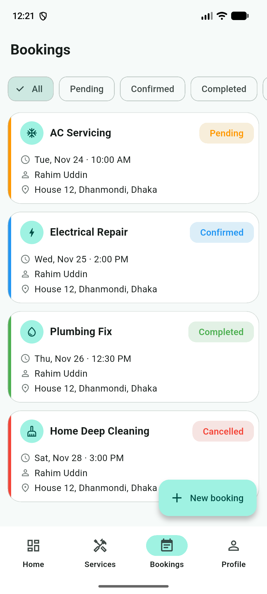
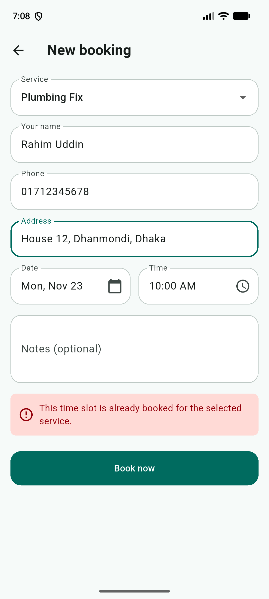

# HatKaj App

Flutter client for **HatKaj**, a maintenance and service booking platform. Talks to [`hatkaj-api`](../hatkaj-api).

<!-- Screenshot placeholders: replace with real images in docs/screenshots/ -->
| Services | Bookings + filter | New booking | Slot conflict |
|---|---|---|---|
|  |  |  |  |

## Features
- Browse services; create a booking (validated form, server errors shown inline, incl. 409 slot taken)
- Booking list with pull-to-refresh, "load more" pagination and **status filter chips**
- **Status updates**: tap a booking's status chip to see only the transitions the API allows
- Explicit loading / empty / error / success states on every list

## Setup
1. Start the API (`php artisan serve --host=0.0.0.0`).
2. Run the app:
```bash
flutter pub get
flutter run                                   # Android emulator (uses 10.0.2.2:8000)
flutter run --dart-define=API_BASE_URL=http://192.168.0.10:8000   # real device: your PC's LAN IP
flutter test
```
The phone and PC must be on the same network. Android cleartext HTTP is enabled for local development only.

## Architecture
```
lib/
  core/          config (base URL), ApiClient (http wrapper), ApiException
  data/          models (fromJson/toJson), repositories (one per API resource)
  presentation/  providers (ChangeNotifier), screens, widgets
```
Screens -> Providers -> Repositories -> ApiClient -> API. Each layer only knows the one below it.

## Key engineering trade-offs
- **Provider over BLoC**: the app has two small lists and one form. `ChangeNotifier` keeps it readable. BLoC would pay off with more complex event flows.
- **`ViewState` enum + `StateView` widget** make loading/empty/error/success explicit and reusable.
- **Failed refresh keeps old data** on screen and shows a snackbar instead of wiping the list.
- **Reload after mutations**: after create/status change the list is refetched, so server ordering and filters stay correct. This costs one extra request but avoids client/server drift.
- **Transition rules duplicated client-side** (`BookingStatus.allowedTransitions`) only to hide invalid actions. The API remains the authority and returns 422 if they diverge.
- **Tests use fake repositories**, so provider and form logic are tested without a network.
