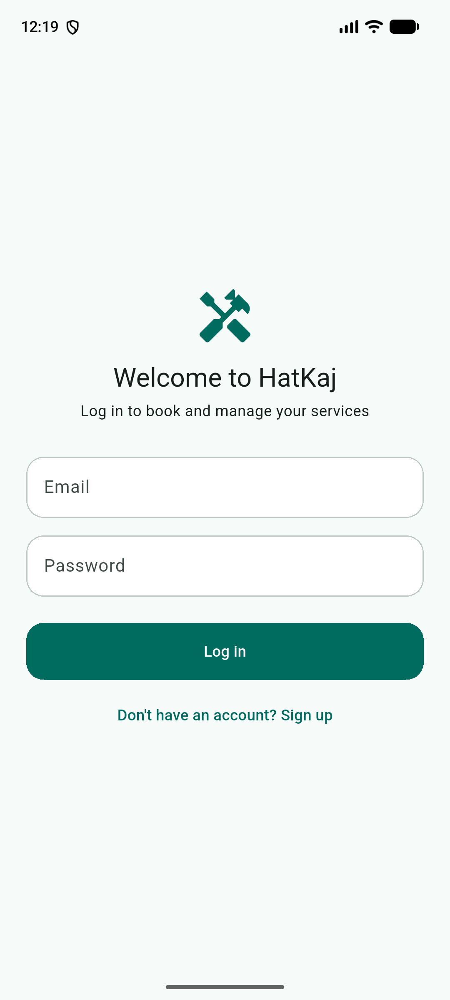
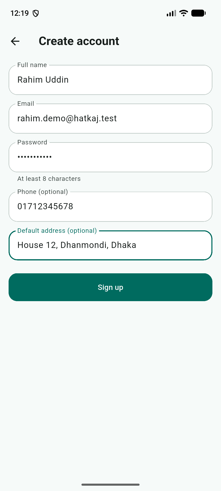
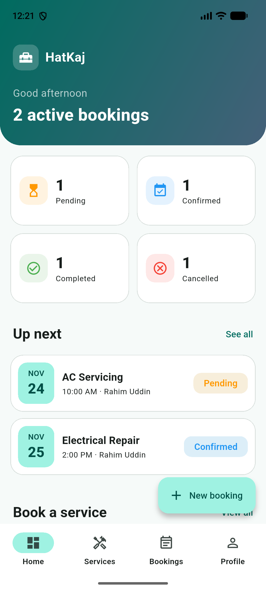
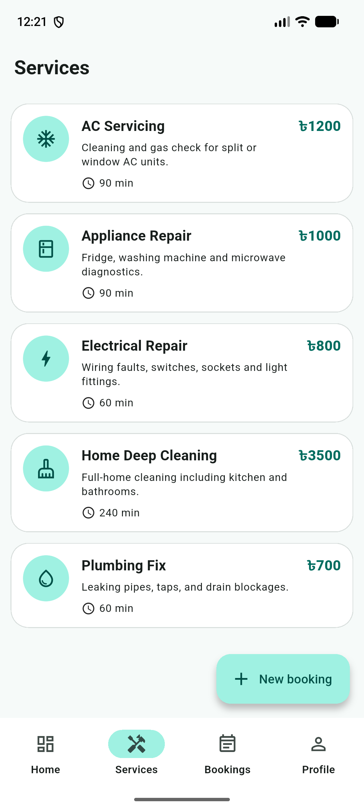
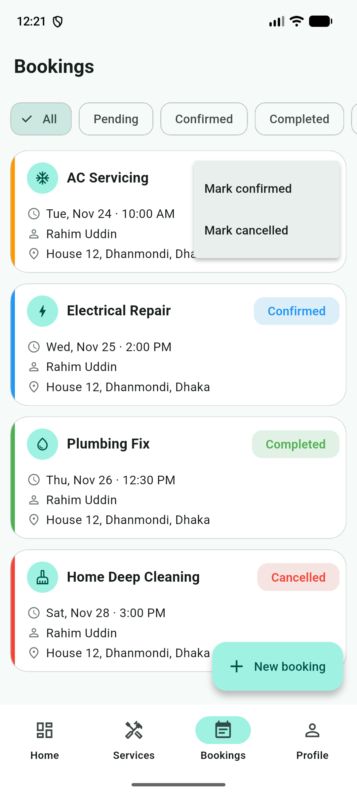
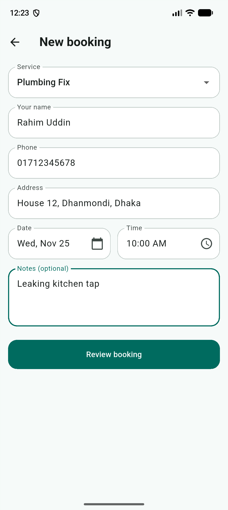
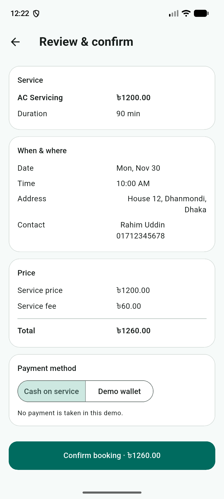
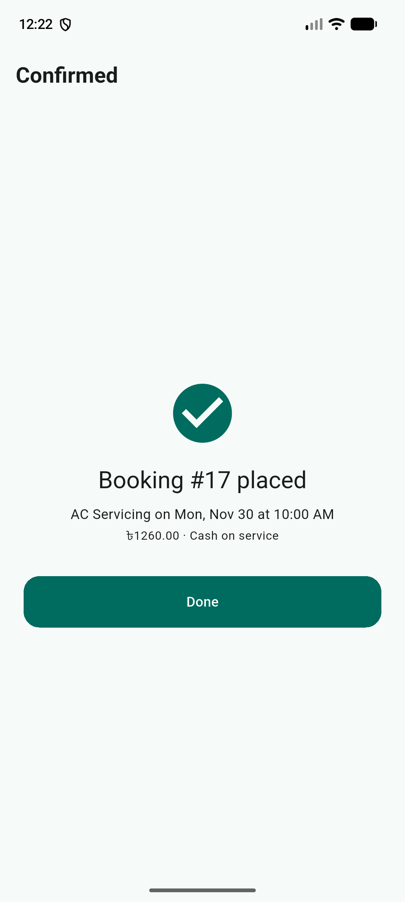
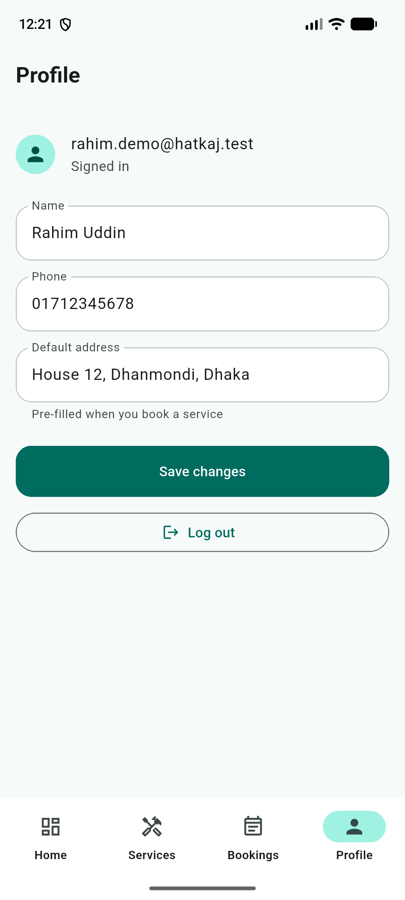

# HatKaj App


Flutter client for **HatKaj**, a smart maintenance and service booking platform. It talks to the Laravel [`hatkaj-api`](https://github.com/deXT-Sadman/hatkaj-api).

Screenshots below are from the Android emulator running against the local API (signed in as a freshly registered user).

<table>
  <tr>
    <td align="center"><br><sub><b>Log in</b></sub></td>
    <td align="center"><br><sub><b>Sign up</b></sub></td>
    <td align="center"><br><sub><b>Home dashboard</b></sub></td>
  </tr>
  <tr>
    <td align="center"><br><sub><b>Services</b></sub></td>
    <td align="center"><br><sub><b>Bookings + filters</b></sub></td>
    <td align="center"><br><sub><b>Status update</b></sub></td>
  </tr>
  <tr>
    <td align="center"><br><sub><b>New booking</b></sub></td>
    <td align="center"><br><sub><b>Slot conflict (409)</b></sub></td>
    <td align="center"><br><sub><b>Review &amp; confirm</b></sub></td>
  </tr>
  <tr>
    <td align="center"><br><sub><b>Confirmation</b></sub></td>
    <td align="center"><br><sub><b>Profile</b></sub></td>
    <td></td>
  </tr>
</table>

## Features
- **Home dashboard**: time-of-day greeting with the number of active bookings, status counts (tap one to open Bookings filtered by it), the next 3 upcoming bookings, quick service shortcuts and pull-to-refresh
- **Services** list, and a **booking form** with validation and server errors shown inline (including the 409 "slot already booked")
- **Bookings** list with pull-to-refresh, "load more" pagination and status filter chips
- **Status updates**: tap a booking's status chip to see only the transitions the API allows
- **Sign up / log in / log out** with a Sanctum API token kept in the device keystore (`flutter_secure_storage`); an expired token signs you out automatically
- **Profile** tab: edit name, phone and default address, which pre-fill the booking form
- **Checkout**: the booking form calls `POST /bookings/preview` and opens a review screen with the server's price breakdown (price, service fee, total), a payment method choice (cash on service or demo wallet; nothing is charged) and an order confirmation
- Explicit loading / empty / error / success states on every screen

## Setup
1. Start the API (`php artisan serve --host=0.0.0.0`, see the API repo). Run `php artisan migrate:fresh --seed` there to get a demo login: `demo@hatkaj.test` / `password`.
2. Run the app:
```bash
flutter pub get
flutter run                                   # Android emulator (uses 10.0.2.2:8000)
flutter run --dart-define=API_BASE_URL=http://192.168.0.10:8000   # real device: your PC's LAN IP
flutter test
```
The phone and PC must be on the same network. Android cleartext HTTP is enabled for local development only.

## Architecture
```
lib/
  core/          config (base URL), theme, ApiClient (http wrapper, bearer token), ApiException, token storage
  data/          models (fromJson/toJson), repositories (one per API resource)
  presentation/  providers (ChangeNotifier), screens, widgets
```
Screens -> Providers -> Repositories -> ApiClient -> API. Each layer only knows the one below it.

| Provider | Owns |
|---|---|
| `AuthProvider` | signed-in user, token, login / register / logout / profile update |
| `ServicesProvider` | service list |
| `BookingsProvider` | bookings list, status filter, pagination, preview, create and status update |
| `DashboardProvider` | per-status counts and upcoming bookings |

## Key engineering trade-offs
- **Provider over BLoC**: the app has a few small lists and one form. `ChangeNotifier` keeps it readable. BLoC would pay off with more complex event flows.
- **`ViewState` enum + `StateView` widget** make loading/empty/error/success explicit and reusable.
- **Data providers only exist while signed in** (built inside `MaterialApp.builder`), so logging out discards the previous user's bookings and resets navigation.
- **Failed refresh keeps old data** on screen and shows a snackbar instead of wiping the list.
- **Reload after mutations**: after create/status change the list is refetched, so server ordering and filters stay correct. This costs one extra request but avoids client/server drift.
- **Dashboard counts come from the server**: each status query returns `meta.total`, so numbers stay correct however many bookings exist, without downloading them all.
- **Transition rules duplicated client-side** (`BookingStatus.allowedTransitions`) only to hide invalid actions. The API remains the authority and returns 422 if they diverge.
- **Tests use fake repositories**, so provider and form logic are tested without a network.
